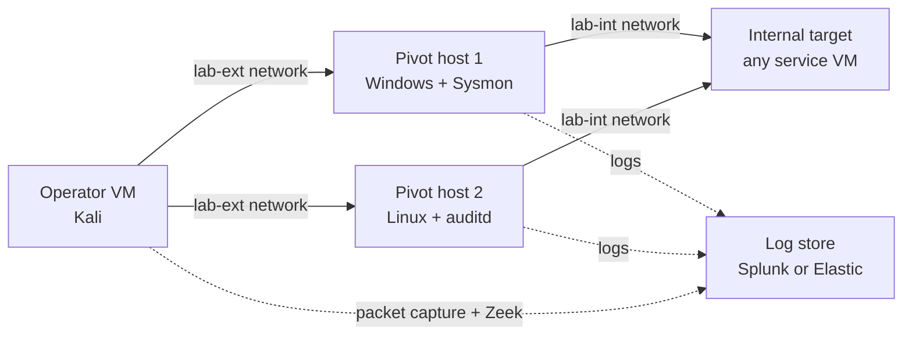

# Lab design

A minimal lab that fits on one laptop with 16 GB of RAM. All networks are host-only or internal.
Nothing is exposed to the internet.

## Machines

| VM | Role | Notes |
|---|---|---|
| Operator | Runs the server side of each tool | Also captures packets on the lab-ext interface |
| Pivot host 1 | Windows client or server evaluation image | Sysmon with a published configuration. Record which one |
| Pivot host 2 | Any current Linux server image | auditd rules for execve and connect |
| Internal target | Reachable only from the pivot hosts | Proves that traffic really went through the tunnel |
| Log store | Splunk (free licence) or Elastic | Can run on the operator VM to save memory |

## Before the first test

1. Snapshot every VM in a clean state. Revert between tools.
2. Record versions: operating systems, Sysmon and its configuration, auditd rules, Zeek, each tool.
3. Run a **baseline**: normal activity with no tunnelling tool, for a stated period. Keep the logs.
4. Confirm time synchronisation across VMs. Correlation depends on it.

## Decisions still open

- Splunk or Elastic as the primary query language for published detections.
- Which public Sysmon configuration to use as the baseline.
